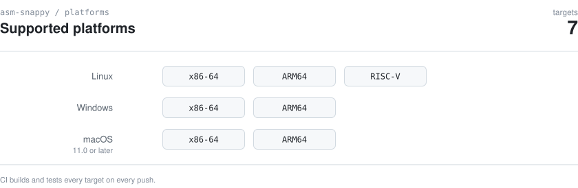
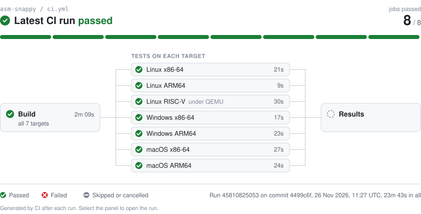

# asm-snappy

Snappy compression for Ethereum, in assembly.

Standard: [asm-standard@0db3e07](https://github.com/bitminetech/asm-standard/blob/0db3e07f58a9ba89c5b6a46925b179de265ee7e8/ARCHITECTURE.md)

<!-- CI generates the supported platforms panel here. -->
<table><tr><td>

<picture><source media="(prefers-color-scheme: dark)" srcset="docs/readme/platforms-dark.svg"></picture>

</td></tr></table>
<!-- End of the supported platforms panel. -->

<!-- CI generates the verification heatmap here. -->
<table><tr><td>

<picture><source media="(prefers-color-scheme: dark)" srcset="docs/heatmap/header-dark.svg"></picture>

<picture><source media="(prefers-color-scheme: dark)" srcset="docs/heatmap/label-block-dark.svg"></picture><a href="docs/reference/block.md#function-snappy_compress_size"><picture><source media="(prefers-color-scheme: dark)" srcset="docs/heatmap/cell-0-dark.svg"></picture></a><a href="docs/reference/block.md#function-snappy_compress"><picture><source media="(prefers-color-scheme: dark)" srcset="docs/heatmap/cell-0-dark.svg"></picture></a><a href="docs/reference/block.md#function-snappy_get_uncompressed_length"><picture><source media="(prefers-color-scheme: dark)" srcset="docs/heatmap/cell-0-dark.svg"></picture></a><a href="docs/reference/block.md#function-snappy_uncompress"><picture><source media="(prefers-color-scheme: dark)" srcset="docs/heatmap/cell-0-dark.svg"></picture></a><a href="docs/reference/block.md#function-snappy_read_length"><picture><source media="(prefers-color-scheme: dark)" srcset="docs/heatmap/cell-0-dark.svg"></picture></a><a href="docs/reference/block.md#function-snappy_uncompress_block"><picture><source media="(prefers-color-scheme: dark)" srcset="docs/heatmap/cell-0-dark.svg"></picture></a><a href="docs/reference/block.md#function-snappy_compress_block"><picture><source media="(prefers-color-scheme: dark)" srcset="docs/heatmap/cell-0-dark.svg"></picture></a> 
<picture><source media="(prefers-color-scheme: dark)" srcset="docs/heatmap/label-framing-dark.svg"></picture><a href="docs/reference/framing.md#function-snappy_frame_compress_size"><picture><source media="(prefers-color-scheme: dark)" srcset="docs/heatmap/cell-0-dark.svg"></picture></a><a href="docs/reference/framing.md#function-snappy_frame_compress"><picture><source media="(prefers-color-scheme: dark)" srcset="docs/heatmap/cell-0-dark.svg"></picture></a><a href="docs/reference/framing.md#function-snappy_frame_uncompress"><picture><source media="(prefers-color-scheme: dark)" srcset="docs/heatmap/cell-0-dark.svg"></picture></a><a href="docs/reference/framing.md#function-snappy_crc32c"><picture><source media="(prefers-color-scheme: dark)" srcset="docs/heatmap/cell-0-dark.svg"></picture></a>

<picture><source media="(prefers-color-scheme: dark)" srcset="docs/heatmap/legend-dark.svg"></picture>

</td></tr></table>
<!-- End of the verification heatmap. -->

<!-- CI generates the CI panel here. -->
<table><tr><td>

<a href="https://github.com/bitminetech/asm-snappy/actions/runs/45810825053"><picture><source media="(prefers-color-scheme: dark)" srcset="docs/readme/ci-dark.svg"></picture></a>

</td></tr></table>
<!-- End of the CI panel. -->

<!-- CI generates the docs panel here. -->
<table><tr><td>

<picture><source media="(prefers-color-scheme: dark)" srcset="docs/readme/docs-header-dark.svg"></picture> 
<picture><source media="(prefers-color-scheme: dark)" srcset="docs/readme/docs-docs-dark.svg"></picture> 
<a href="docs/reference/block.md"><picture><source media="(prefers-color-scheme: dark)" srcset="docs/readme/docs-doc-block-dark.svg"></picture></a><a href="docs/reference/framing.md"><picture><source media="(prefers-color-scheme: dark)" srcset="docs/readme/docs-doc-framing-dark.svg"></picture></a>

<picture><source media="(prefers-color-scheme: dark)" srcset="docs/readme/docs-footer-dark.svg"></picture>

</td></tr></table>
<!-- End of the docs panel. -->
